<div align="center">


# Spinyin-lyric for Spotify

**Standalone Liquid Glass lyrics stage & 100% offline Mandarin Pinyin smart lyrics for Spotify.**

**English** | [简体中文](README.zh-CN.md)

[](https://github.com/Eugenewijaya/spinyin-lyric/releases)
[](https://spicetify.app)
[](https://eugenewijaya.github.io/spinyin-lyric/)
[](#key-features)
[](LICENSE)

<br />

<a href="https://eugenewijaya.github.io/spinyin-lyric/">
  
</a>

<sub>Explore the interactive preview & installer guide on the <a href="https://eugenewijaya.github.io/spinyin-lyric/"><strong>Spinyin-lyric Website →</strong></a></sub>

</div>

---

## Quick Install

Requires [Spicetify](https://spicetify.app/docs/getting-started) installed on Spotify Desktop.

### Windows (PowerShell)

```powershell
iwr -useb https://raw.githubusercontent.com/Eugenewijaya/spinyin-lyric/main/install.ps1 | iex
```

### macOS / Linux

```sh
curl -fsSL https://raw.githubusercontent.com/Eugenewijaya/spinyin-lyric/main/install.sh | sh
```

### Spicetify Marketplace

1. Open Spotify and go to **Marketplace → Extensions**.
2. Search for **Spinyin-lyric for Spotify**.
3. Click **Install** and reload Spotify.

---

## Key Features

- **Standalone Liquid Glass Lyrics Stage** — Open an integrated, frosted liquid-glass lyrics view directly from the Spotify playbar (or **Profile Menu → Open Spinyin Lyrics Stage**, close anytime with `Escape`). Works independently with synced lyrics, click-to-seek on any line, interactive playback controls, fullscreen mode, and a toggleable **Ambient** album-art or **Low-RAM** dark backdrop.
- **100% Offline Pinyin Engine** — Bundles [`pinyin-pro`](https://github.com/zh-lx/pinyin-pro) directly inside `spinyin-lyric.js` for instant local Hanzi-to-Pinyin conversion with zero external translation API calls and full CSP safety. Handles Simplified (`简体`), Traditional (`繁體`), context-aware polyphones (`音乐` → `yīn yuè`, `银行` → `yín háng`), tone sandhi, and mixed Chinese/English lines.
- **Dual & Pinyin-Only Display Modes** — Switch seamlessly between **Hanzi + Pinyin** (dual running lyrics) and **Pinyin Only** (hides Hanzi so crisp, full-size Pinyin becomes the primary running lyric).
- **3 Tone Styles** — Cycle between **Tone Marks** (`nǐ hǎo`), **Tone Numbers** (`ni3 hao3`), and **Plain** (`ni hao`) at any time.
- **Floating Quick Pill** — A compact glass control pill appears automatically when Mandarin lyrics are on screen so you can toggle ON/OFF, switch between `Hanzi + Pinyin` and `Pinyin Only`, or cycle tone styles in one click.
- **Spinyin Studio Modal** — Open from the playbar, stage toolbar, or Profile menu to configure annotation scopes, inspect the currently playing track, or paste any Mandarin text for an instant Ruby-annotated preview with one-click copy.
- **Automatic Native Lyrics & Metadata Pinyin** — Automatically adds Pinyin to Spotify's native lyrics views as well as Mandarin song titles, albums, and artist names across Spotify desktop layouts.
- **Lightweight & Respectful** — Zero CPU overhead when the stage is closed, bounded in-memory caching, and full support for `prefers-reduced-motion`.

---

## Tone Styles

Switch anytime from the Liquid Glass Stage toolbar, Floating Quick Pill, Spinyin Studio modal, or Profile menu:

| Style | Example (`月亮代表我的心`) |
| --- | --- |
| **Tone Marks** *(default)* | `yuè liàng dài biǎo wǒ de xīn` |
| **Tone Numbers** | `yue4 liang4 dai4 biao3 wo3 de0 xin1` |
| **Plain** | `yue liang dai biao wo de xin` |

---

## Update & Uninstall

**Update:** Re-run the Quick Install command for your platform.

**Uninstall (Windows PowerShell):**

```powershell
$env:SPINYIN_UNINSTALL="1"; iwr -useb https://raw.githubusercontent.com/Eugenewijaya/spinyin-lyric/main/install.ps1 | iex; Remove-Item Env:SPINYIN_UNINSTALL
```

**Uninstall (macOS / Linux):**

```sh
curl -fsSL https://raw.githubusercontent.com/Eugenewijaya/spinyin-lyric/main/install.sh | sh -s -- --uninstall
```

---

## Versioning & Changelog

This project follows [Semantic Versioning](https://semver.org/).

### `v2.2.0`
- Fixed Standalone Stage topbar spacing so controls sit cleanly below Spotify's native Windows/macOS titlebar and window buttons (`-`, `□`, `×`).
- Major performance & smoothness overhaul: replaced full-screen `blur(72px)` and heavy `backdrop-filter` with a zero-blur pre-sampled ambient gradient, paused background DOM observers while Stage is open, and removed synchronous layout reflows.

### `v2.1.0`
- Added global lyrics auto-connect: automatically detects and annotates Mandarin lyrics across third-party Spotify lyrics extensions (including Dual and Pinyin-Only modes) whenever Spinyin is active.
- Unified child-wrapped and bare-text Pinyin-Only rules so custom lyrics extensions stay crisp without breaking layout or sync.

### `v2.0.0`
- Added the built-in **Standalone Liquid Glass Lyrics Stage** accessible from the Spotify playbar and Profile menu (`Escape` to close, plus Fullscreen toggle).
- Added independent synced lyrics fetching with in-memory track caching, smooth centered active-line scrolling, click-to-seek, and integrated playback & scrubber controls.
- Added adaptive album-art **Ambient** backdrop alongside a toggleable **Low-RAM** dark backdrop mode (`Ambient` / `Low RAM`).
- Added cross-platform POSIX installer script (`install.sh` with `--uninstall` support), Simplified Chinese documentation (`README.zh-CN.md`), brand icon assets, and the live project site.

### `v1.1.0`
- Added **Pinyin Only** primary lyric mode to hide Hanzi and render crisp, full-size Pinyin as the main running lyric.
- Improved active-line legibility and removed blur/washout artifacts on highlighted Pinyin lines.
- Added 1-click display mode switching (`Hanzi + Pinyin` ↔ `Pinyin Only`) across the Floating Quick Pill, Spinyin Studio modal, and Profile menu.

### `v1.0.0`
- Initial open-source release with bundled offline `pinyin-pro` engine and isolated UMD loading.
- Automatic real-time Pinyin annotation for Spotify native lyrics, track titles, albums, and artists.
- Floating Quick Pill, Spinyin Studio modal with Ruby preview, 3 tone styles, PowerShell installer (`install.ps1`), and Spicetify Marketplace manifest.

---

## Support the Developer

If **Spinyin-lyric for Spotify** helps you enjoy and sing along to Mandarin music, consider supporting ongoing maintenance and updates by [@Eugenewijaya](https://github.com/Eugenewijaya):

- **Star the repository** on GitHub to help more listeners find it: [Eugenewijaya/spinyin-lyric](https://github.com/Eugenewijaya/spinyin-lyric)
- **Sponsor on GitHub**: [github.com/sponsors/Eugenewijaya](https://github.com/sponsors/Eugenewijaya)
- **Report bugs or request features**: [Open an Issue](https://github.com/Eugenewijaya/spinyin-lyric/issues)
- **Contribute**: Pull requests are always welcome.

<div align="center">
<sub>Built by <a href="https://github.com/Eugenewijaya">@Eugenewijaya</a> · Offline engine by <a href="https://github.com/zh-lx/pinyin-pro">pinyin-pro</a> · Released under the <a href="LICENSE">MIT License</a></sub>
</div>
