<div align="center">


# Spinyin-lyric for Spotify

**专为 Spotify 打造的独立液态玻璃歌词舞台与 100% 离线中文拼音智能歌词扩展。**

[English](README.md) | **简体中文**

[](https://github.com/Eugenewijaya/spinyin-lyric/releases)
[](https://spicetify.app)
[](https://eugenewijaya.github.io/spinyin-lyric/)
[](#核心功能)
[](LICENSE)

<br />

<a href="https://eugenewijaya.github.io/spinyin-lyric/">
  
</a>

<sub>前往 <a href="https://eugenewijaya.github.io/spinyin-lyric/"><strong>Spinyin-lyric 官方网站 →</strong></a> 体验实时交互预览与一键安装引导</sub>

</div>

---

## 快速安装

需先在桌面版 Spotify 上安装 [Spicetify](https://spicetify.app/docs/getting-started)。

### Windows（PowerShell）

```powershell
iwr -useb https://raw.githubusercontent.com/Eugenewijaya/spinyin-lyric/main/install.ps1 | iex
```

### macOS / Linux

```sh
curl -fsSL https://raw.githubusercontent.com/Eugenewijaya/spinyin-lyric/main/install.sh | sh
```

### Spicetify Marketplace

1. 打开 Spotify，进入 **Marketplace → Extensions**。
2. 搜索 **Spinyin-lyric for Spotify**。
3. 点击 **Install** 并重载 Spotify。

---

## 核心功能

- **独立液态玻璃歌词舞台（Liquid Glass Lyrics Stage）** — 点击 Spotify 播放栏按钮（或通过 **个人资料菜单 → Open Spinyin Lyrics Stage**）即可打开原生融合的磨砂液态玻璃歌词视图，按 `Escape` 键随时关闭。内置独立同步歌词获取与内存缓存，支持点击任意歌词行跳转进度、播放控制与进度条拖拽、全屏模式，以及自适应专辑封面 **氛围背景（Ambient）** 与 **低内存深色背景（Low RAM）** 自由切换。
- **100% 离线拼音引擎** — 内置 [`pinyin-pro`](https://github.com/zh-lx/pinyin-pro) 离线转换引擎于 `spinyin-lyric.js` 中，零外部翻译接口请求、无速率限制且完全符合 CSP 安全策略。准确支持简体（`简体`）、繁体（`繁體`）、语境多音字识别（如 `音乐` → `yīn yuè`、`银行` → `yín háng`）、变调规则及中英混排歌词。
- **双语显示与纯拼音主歌词模式** — 支持 **汉字 + 拼音（Hanzi + Pinyin）** 双行对照，或切换为 **仅显示拼音（Pinyin Only）**，隐藏汉字并将清晰锐利的大号拼音作为主歌词滚动显示。
- **三种声调样式** — 随时在 **声调符号**（`nǐ hǎo`）、**数字声调**（`ni3 hao3`）与 **无声调**（`ni hao`）之间一键切换。
- **悬浮快捷胶囊（Floating Quick Pill）** — 仅在页面出现中文歌词时自动浮现，轻点即可开关拼音、切换 `Hanzi + Pinyin` / `Pinyin Only` 模式或轮换声调格式。
- **Spinyin Studio 弹窗工具** — 可从播放栏、歌词舞台顶栏或个人资料菜单打开，用于配置注音范围、查看当前曲目信息，或粘贴任意中文文本实时生成带注音（Ruby）预览并一键复制。
- **自动注音 Spotify 原生歌词与曲目信息** — 自动为 Spotify 原生歌词界面以及桌面端各处的中文歌曲名、专辑名和歌手名标注拼音。
- **轻量省资源** — 歌词舞台关闭时零后台循环占用，配合有界内存缓存，并遵循系统的 `prefers-reduced-motion` 减弱动态效果设置。

---

## 声调样式

可通过液态玻璃歌词舞台顶栏、悬浮快捷胶囊、Spinyin Studio 弹窗或个人资料菜单随时切换：

| 样式 | 示例（`月亮代表我的心`） |
| --- | --- |
| **声调符号** *（默认）* | `yuè liàng dài biǎo wǒ de xīn` |
| **数字声调** | `yue4 liang4 dai4 biao3 wo3 de0 xin1` |
| **无声调** | `yue liang dai biao wo de xin` |

---

## 更新与卸载

**更新：** 重新运行对应平台的一键安装命令即可覆盖升级至最新版本。

**卸载（Windows PowerShell）：**

```powershell
$env:SPINYIN_UNINSTALL="1"; iwr -useb https://raw.githubusercontent.com/Eugenewijaya/spinyin-lyric/main/install.ps1 | iex; Remove-Item Env:SPINYIN_UNINSTALL
```

**卸载（macOS / Linux）：**

```sh
curl -fsSL https://raw.githubusercontent.com/Eugenewijaya/spinyin-lyric/main/install.sh | sh -s -- --uninstall
```

---

## 版本记录

本项目遵循 [语义化版本规范（SemVer）](https://semver.org/)。

### `v2.1.0`
- 新增全局歌词扩展自动兼容：开启 Spinyin 后可自动识别并适配 Spotify 原生歌词及各类第三方歌词扩展（同时支持双语模式与纯拼音模式）。
- 统一子元素包裹与纯文本歌词行的纯拼音替换规则，保持排版清晰且不破坏原有滚动同步。

### `v2.0.0`
- 新增内置 **独立液态玻璃歌词舞台（Standalone Liquid Glass Lyrics Stage）**，支持播放栏与个人资料菜单一键开启、`Escape` 关闭及全屏模式。
- 新增独立同步歌词获取与曲目内存缓存，支持当前行平滑居中滚动、点击歌词行跳转进度以及内置播放与进度条控制。
- 新增自适应专辑封面 **氛围背景（Ambient）** 与可切换的 **低内存深色背景（Low RAM）** 模式。
- 新增适用于 macOS / Linux 的 POSIX 一键安装脚本（`install.sh`，支持 `--uninstall`）、简体中文文档（`README.zh-CN.md`）、品牌图标资产及项目官方网站。

### `v1.1.0`
- 新增 **纯拼音主歌词（Pinyin Only）** 模式，可隐藏汉字并以清晰大号拼音作为主滚动歌词。
- 优化高亮歌词行的渲染清晰度，消除拼音模糊与渐变发灰问题。
- 在悬浮快捷胶囊、Spinyin Studio 弹窗与个人资料菜单中加入 `Hanzi + Pinyin` ↔ `Pinyin Only` 一键切换。

### `v1.0.0`
- 首个开源版本发布，内置离线 `pinyin-pro` 引擎与隔离式 UMD 加载机制。
- 支持 Spotify 原生歌词及歌曲名、专辑名、歌手名实时自动拼音标注。
- 提供悬浮快捷胶囊、带 Ruby 注音预览的 Spinyin Studio 弹窗、三种声调格式、PowerShell 一键安装脚本（`install.ps1`）与 Spicetify Marketplace 清单。

---

## 支持开发者

如果 **Spinyin-lyric for Spotify** 让你的中文音乐聆听与跟唱体验更顺手，欢迎支持作者 [@Eugenewijaya](https://github.com/Eugenewijaya) 的持续维护与更新：

- **点亮 Star**：在 GitHub 上收藏本项目，让更多听众发现它：[Eugenewijaya/spinyin-lyric](https://github.com/Eugenewijaya/spinyin-lyric)
- **GitHub Sponsors 赞助**：[github.com/sponsors/Eugenewijaya](https://github.com/sponsors/Eugenewijaya)
- **反馈问题或提出建议**：[提交 Issue](https://github.com/Eugenewijaya/spinyin-lyric/issues)
- **参与贡献**：随时欢迎提交 Pull Request。

<div align="center">
<sub>由 <a href="https://github.com/Eugenewijaya">@Eugenewijaya</a> 打造 · 离线拼音引擎由 <a href="https://github.com/zh-lx/pinyin-pro">pinyin-pro</a> 驱动 · 基于 <a href="LICENSE">MIT 协议</a> 开源</sub>
</div>
